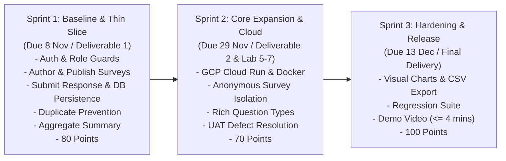

# Three-Sprint Plan & Scope Allocation (Part D)
**Course:** CPE 334 Introduction to Software Engineering in the Age of AI Agents  
**Theme 10:** Review, Feedback, and Survey System (UniPulse)  
**Document Version:** 1.0.0  

---

## 1. Roadmap & Checkpoint Milestones Overview
The UniPulse project follows a rigorous three-sprint agile delivery model where every sprint delivers an integrated, tested, and verifiable product release.

---

## 2. Sprint 1: Engineering Baseline & Small Deployable Product
* **Target Delivery Date:** 8 November 2026 (Deliverable 1 Checkpoint)
* **Point Value:** 80 Points (8% of Course Grade)
* **Sprint Goal:** Establish the complete engineering foundation (SRS, SDS, Traceability, Git workflow), and implement an end-to-end working vertical slice from UI to API to persistent PostgreSQL database. Demonstrate real authentication, server-enforced role authorization, published survey discovery, response submission with strict single-vote duplicate prevention, and owner aggregate metric summaries.

### Allocated Features & Scope
| Feature ID | Feature Name | Core Outcome |
| :--- | :--- | :--- |
| `F-01` | Authentication & Session Management | Registration, login, bcrypt hashing, JWT issuance, and logout revocation. |
| `F-02` | Server-Side Role & Ownership Guards | Route middleware protecting owner actions and scoping respondent queries. |
| `F-03` | Create Draft Survey with Validation Limits | Title, description, category setup with character length validations. |
| `F-04` | Survey Question Authoring | Adding and ordering Text, Choice, and Rating questions while in Draft. |
| `F-05` | Survey Lifecycle (Publish & Close) | Enforcing state machine `DRAFT` $\rightarrow$ `PUBLISHED` $\rightarrow$ `CLOSED`. |
| `F-06` | Browse Published Surveys | Respondent survey catalog with status indicators. |
| `F-07` | Survey Form Question Rendering | Clean respondent form handling dynamic question types. |
| `F-08` | Response Submission & DB Persistence | Validated response capture written to PostgreSQL tables. |
| `F-09` | Duplicate Submission Prevention | Composite unique index blocking repeat responses with 409 Conflict. |
| `F-10` | Personal Submission History | Respondent receipt page verifying saved answers. |
| `F-12` | Aggregate Results Summary Dashboard | Owner analytics page displaying calculated totals and averages. |

### Sprint 1 Feasibility & Critical Path Analysis
1. **Critical Path:**
   `Database Schema (Prisma)` $\rightarrow$ `Auth & Role Middleware (F-01, F-02)` $\rightarrow$ `Survey Publishing (F-03..F-05)` $\rightarrow$ `Response Submission (F-08, F-09)` $\rightarrow$ `Aggregate Reporting (F-12)`.
2. **De-risking Strategy:**
   - Seed scripts provide ready-to-test accounts (`owner1`, `student1`, `student2`).
   - PostgreSQL composite unique index handles concurrency without complex Redis locks.
   - Cloud deployment is intentionally isolated to Lab 5; Sprint 1 runs reproducibly on local Docker / Node.js.

---

## 3. Sprint 2: Core Expansion & Cloud Delivery
* **Target Delivery Date:** 29 November 2026 (Deliverable 2 Checkpoint)
* **Point Value:** 70 Points (7% of Course Grade) + Labs 5, 6, 7 (300 Lab Points)
* **Sprint Goal:** Expand core workflows to include anonymous survey modes and complex question types. Package into Docker and deploy on GCP Cloud Run with Cloud SQL through a repeatable CI/CD pipeline (Lab 5). Execute cross-team UAT defect logging and resolution (Lab 6) and implement an instructor-guided change request via TDD (Lab 7).

### Allocated Features & Scope
| Feature ID | Feature Name | Core Outcome |
| :--- | :--- | :--- |
| `F-13` | Anonymous Response Mode | Cryptographic separation of identity tokens from answer records. |
| `F-14` | Advanced Question Types | Multi-select checkboxes, matrix rating questions, optional fields. |
| `F-15` | Scheduled Expiry & Auto Closure | Timed survey expiration jobs closing active surveys automatically. |
| `F-16` | Respondent Eligibility Filtering | Cohort access checks restricting surveys to specific user groups. |
| `F-17` | Survey Template Cloning | One-click duplication of closed surveys for subsequent terms. |
| `Lab 5` | Docker & GCP Cloud Run CI/CD | GitHub Actions pipeline building container and deploying to Cloud Run. |
| `Lab 6` | Cross-Team UAT & Defect Triage | Testing peer team's app, filing bugs, and fixing verified defects. |
| `Lab 7` | Maintenance Exercise via TDD | Applying approved business rule change with red/green test proof. |

---

## 4. Sprint 3: Completion, Hardening & Final Product Release
* **Target Delivery Date:** 13 December 2026 (Final Project Delivery)
* **Point Value:** 100 Points (10% of Course Grade)
* **Sprint Goal:** Finish all remaining analytical capabilities, conduct full system hardening against security and boundary vulnerabilities, run complete automated regression suites, produce reproducible deployment artifacts, and record a comprehensive demonstration video.

### Allocated Features & Scope
| Feature ID | Feature Name | Core Outcome |
| :--- | :--- | :--- |
| `F-18` | Visual Analytics & Distribution Charts | Interactive charting for score distribution curves and frequencies. |
| `F-19` | Survey Results Export (CSV / JSON) | Structured file export of survey results for offline academic review. |
| `F-20` | Health Check & System Observability | Production readiness probe and database connection pooling metrics. |
| `F-21` | Error Resilience & Hardening | Input fuzzing defenses, accessibility audit, and edge-case handling. |
| `Final Video`| Demonstration Video (Max 4 Mins) | High-impact product demo with both team members presenting live journeys. |

---

## 5. Summary Table: Sprints across Deliverables

| Deliverable | Milestone Checkpoint | Points | Deliverable Artifacts |
| :--- | :--- | :---: | :--- |
| **Deliverable 1** | Sprint 1 Baseline & Slice | 80 | Self-contained PDF (Parts A–F), local runnable release on `main`, seed data, automated test suite. |
| **Deliverable 2** | Sprint 2 Expansion & Candidate | 70 | Deployed candidate on GCP Cloud Run, continuity verification, Sprint 2 features, Lab 5-7 outcomes. |
| **Final Delivery** | Sprints 1–3 Complete Release | 100 | Complete verified product on GCP, regression test suite, UAT sign-off, YouTube demo video ($\le 4$ mins). |
| **Total** | | **250** | **25% of Course Grade** |
