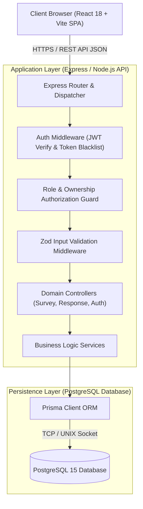
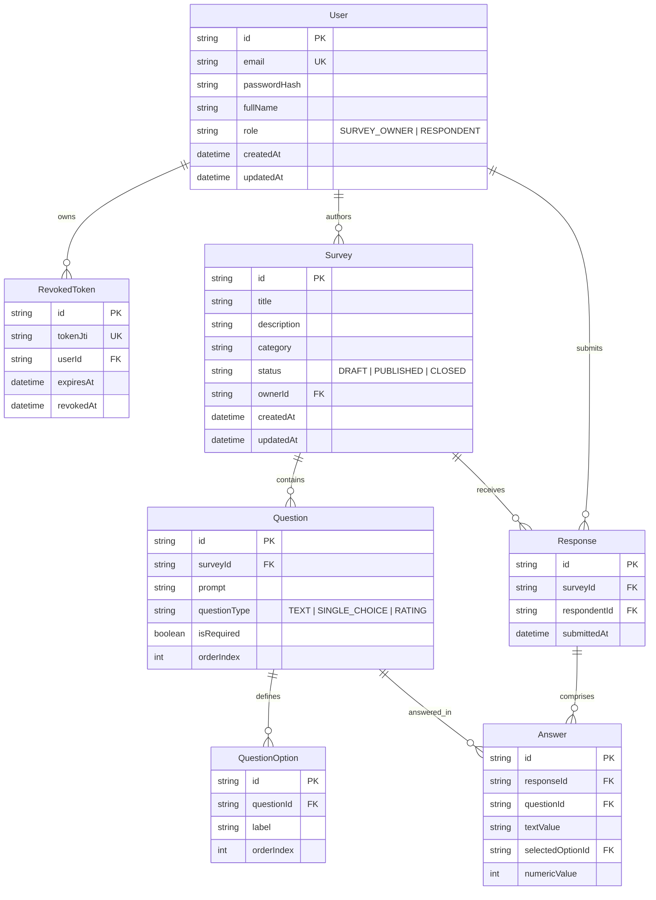

# System-Level Software Design Specification (System-Level SDS)
**Course:** CPE 334 Introduction to Software Engineering in the Age of AI Agents  
**Theme 10:** Review, Feedback, and Survey System (UniPulse)  
**Document Version:** 1.0.0 (Part C Baseline)  

---

## 1. System Architecture & Tech Stack

### 1.1 Architecture Pattern: Full-Stack Modular Monolith
UniPulse is engineered as a full-stack modular monolith featuring clean separation of concerns:
1. **Presentation Layer (Frontend):** React 18 Single Page Application (SPA) powered by Vite, Tailwind CSS, and TanStack React Query for declarative state management, asynchronous data caching, and responsive UI rendering.
2. **Application / API Layer (Backend):** Node.js runtime executing Express.js with TypeScript in strict mode. Architecture follows controller-service-repository patterns with isolated middleware layers for authentication, schema validation (Zod), and uniform error dispatching.
3. **Persistence Layer (Database):** Relational PostgreSQL 15 managed via Prisma ORM for type-safe query construction, automated schema migrations, and relational integrity enforcement.



---

## 2. Relational Data Model & Schema Design

### 2.1 Entity Relationship Diagram (ERD)



### 2.2 Relational Integrity & Engine Constraints
- **Composite Unique Index on Response:** `@@unique([surveyId, respondentId])` guarantees at the database storage engine level that a respondent can only create one response per survey, preventing duplicate submissions during concurrent requests.
- **Foreign Key Cascades:**
  - `Survey` $\rightarrow$ `Question` (`onDelete: Cascade` when in `DRAFT`).
  - `Question` $\rightarrow$ `QuestionOption` (`onDelete: Cascade`).
  - `Response` $\rightarrow$ `Answer` (`onDelete: Cascade`).
- **Data Validation Types:**
  - `Survey.status` $\in$ `['DRAFT', 'PUBLISHED', 'CLOSED']`.
  - `Question.questionType` $\in$ `['TEXT', 'SINGLE_CHOICE', 'RATING']`.
  - `User.role` $\in$ `['SURVEY_OWNER', 'RESPONDENT']`.
  - `Answer.numericValue` constrained within $[1, 5]$ when associated question type is `RATING`.

---

## 3. UI Structure & Conventions

### 3.1 Navigation & Screen Architecture
1. **Public/Auth Views:**
   - `/login` – Credential entry form with pre-filled demo role buttons for rapid evaluation.
   - `/register` – Account sign-up with role selection.
2. **Survey Owner Views:**
   - `/owner/surveys` – Survey management dashboard showing cards for Drafts, Published, and Closed surveys with quick status filters.
   - `/owner/surveys/new` – Survey authoring form for title, description, category, and dynamic question list builder.
   - `/owner/surveys/:id/analytics` – Aggregate summary dashboard showing participation metrics, rating averages, and response distributions.
3. **Respondent Views:**
   - `/respondent/surveys` – Active surveys directory showing available surveys with status badges (`Completed` vs `Start Survey`).
   - `/respondent/surveys/:id/take` – Interactive survey questionnaire form with real-time validation and submission handling.
   - `/respondent/history` – Receipt log of completed surveys with timestamps and read-only answer review.

### 3.2 Standard UI Component States
- **Loading State:** Centered skeleton loaders and disabled submission buttons with animated spinning icons.
- **Empty State:** Informative illustrated cards with clear call-to-action (e.g., *"No published surveys available at this time"* or *"You haven't submitted any responses yet"*).
- **Error State:** Dismissible alert banners highlighting specific HTTP error codes and validation error lists.
- **Success State:** Toast notifications confirming action execution (e.g., *"Survey published successfully"*, *"Your response has been recorded"*).

---

## 4. API Architecture & Conventions

### 4.1 RESTful Endpoint Conventions
All endpoints follow standard resource naming with uniform prefix `/api/v1/`:
- **Auth:** `POST /api/v1/auth/register`, `POST /api/v1/auth/login`, `GET /api/v1/auth/me`, `POST /api/v1/auth/logout`
- **Surveys:** `GET /api/v1/surveys`, `POST /api/v1/surveys`, `GET /api/v1/surveys/:id`, `PATCH /api/v1/surveys/:id`, `DELETE /api/v1/surveys/:id`
- **Lifecycle:** `POST /api/v1/surveys/:id/publish`, `POST /api/v1/surveys/:id/close`
- **Questions:** `POST /api/v1/surveys/:id/questions`, `DELETE /api/v1/questions/:id`
- **Responses:** `POST /api/v1/surveys/:id/responses`, `GET /api/v1/responses/my-history`
- **Analytics:** `GET /api/v1/surveys/:id/analytics`

### 4.2 Uniform Payload Contracts

#### Success Response Envelope (HTTP 200 / 201)
```json
{
  "data": { ... }
}
```

#### Error Response Envelope (HTTP 4xx / 5xx)
```json
{
  "error": {
    "code": "DUPLICATE_SUBMISSION",
    "message": "You have already submitted a response to this survey.",
    "details": {
      "surveyId": "srv_123",
      "submittedAt": "2026-11-12T10:00:00.000Z"
    }
  }
}
```

### 4.3 Standard Status Codes
| HTTP Status | Semantic Usage |
| :--- | :--- |
| **200 OK** | Resource successfully retrieved or non-creation mutation completed. |
| **201 Created** | Resource created (user registered, survey authored, response submitted). |
| **400 Bad Request** | Request syntax error, invalid state transition (e.g., publishing empty survey). |
| **401 Unauthorized** | Missing, malformed, expired, or revoked JWT bearer token. |
| **403 Forbidden** | Authenticated user lacks required role or ownership rights to requested resource. |
| **404 Not Found** | Target resource ID does not exist. |
| **409 Conflict** | Violation of uniqueness rule (e.g., duplicate survey submission or existing email). |
| **422 Unprocessable Entity** | Schema validation failure (e.g., rating out of $[1, 5]$ bounds). |
| **500 Internal Server Error** | Unexpected server failure; masked from exposing stack traces to clients. |

---

## 5. Role & Permission Matrix

| Endpoint & Operation | HTTP Method | `GUEST` (Unauthenticated) | `RESPONDENT` | `SURVEY_OWNER` | Ownership Rule |
| :--- | :--- | :---: | :---: | :---: | :--- |
| `POST /auth/register` | POST | Allow | Allow | Allow | Public access |
| `POST /auth/login` | POST | Allow | Allow | Allow | Public access |
| `GET /auth/me` | GET | Reject (401) | Allow | Allow | Returns authenticated token identity |
| `POST /auth/logout` | POST | Reject (401) | Allow | Allow | Revokes current token in database |
| `GET /surveys` | GET | Reject (401) | Allow (Published only) | Allow (Owner's drafts + all published) | Scoped by role query filter |
| `POST /surveys` | POST | Reject (401) | Reject (403) | Allow | Restricted to Survey Owners |
| `GET /surveys/:id` | GET | Reject (401) | Allow (If published) | Allow | Owner sees own drafts; others 403 on draft |
| `PATCH /surveys/:id` | PATCH | Reject (401) | Reject (403) | Allow (Owner only) | `survey.ownerId === auth.userId` & `status === DRAFT` |
| `POST /surveys/:id/publish` | POST | Reject (401) | Reject (403) | Allow (Owner only) | `survey.ownerId === auth.userId` & $\ge 1$ question |
| `POST /surveys/:id/close` | POST | Reject (401) | Reject (403) | Allow (Owner only) | `survey.ownerId === auth.userId` & `status === PUBLISHED` |
| `POST /surveys/:id/responses` | POST | Reject (401) | Allow | Reject (403) | Restricted to Respondents; rejected if owner |
| `GET /responses/my-history` | GET | Reject (401) | Allow | Reject (403) | Strictly queries `WHERE respondentId = auth.userId` |
| `GET /surveys/:id/analytics` | GET | Reject (401) | Reject (403) | Allow (Owner only) | `survey.ownerId === auth.userId` |

---

## 6. Credential & Session Management Design
1. **Password Hashing:** Passwords hashed with `bcryptjs` using cost factor 12 before persistence.
2. **Session Token Issuance:** JWT issued upon successful credential verification. Payload contains `{ userId, email, role, jti }` signed with `JWT_SECRET` (HS256) and standard 24-hour expiration.
3. **Token Invalidation on Logout:** When `/api/v1/auth/logout` is invoked, the token's unique ID (`jti`) is stored in the `RevokedToken` table with an expiration timestamp. Authentication middleware cross-checks incoming tokens against `RevokedToken` to guarantee instant revocation.

---

## 7. Configuration & Cloud Deployment Architecture (Lab 5 & Beyond)

### 7.1 Containerization Design
- **Multi-stage Dockerfile:** Builds client static assets via Vite, compiles backend TypeScript to optimized JavaScript bundle, and generates Prisma client bindings.
- **Production Container:** Lightweight Alpine Linux image running Node.js in unprivileged user mode (`node`), exposing port 8080.

### 7.2 Target GCP Infrastructure
- **Server:** Google Cloud Run service hosting containerized Node.js/Express application.
- **Database:** Google Cloud SQL managed PostgreSQL instance connected via Cloud Run Cloud SQL Auth Proxy.
- **Secrets:** Environment variables (`DATABASE_URL`, `JWT_SECRET`, `NODE_ENV`) injected securely through Cloud Run service configuration without committing to source repository.
